# Consilium

A Windows workspace for calendars, documents, conversations and visual AI workflows. Built with Tauri 2, Rust, React, SQLite, React Flow and the bundled Wordcraft editor.

**Current release: 3.0.0 — first stable release.** [Download the Windows installer](https://github.com/Ahmed04045/Consilium/releases/latest). The installer is unsigned and updates are installed manually.

The installed application is named **Consilium Next** and uses `%LOCALAPPDATA%\Consilium Next`. This preserves the existing app identity, data and credential namespace when upgrading the tested builds.

## Demo

[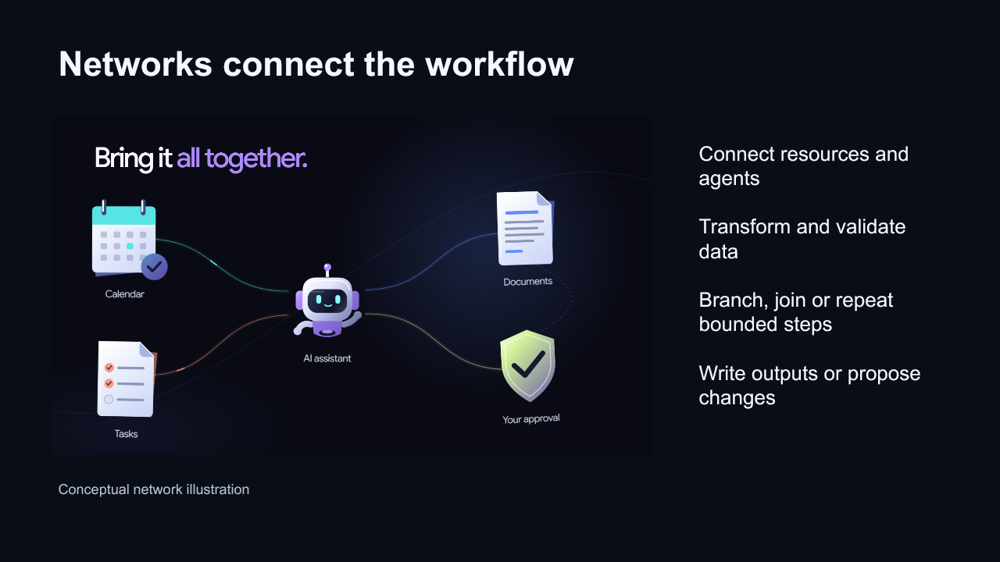](https://github.com/Ahmed04045/Consilium/releases/download/v3.0.0/consilium-promo.mp4)

[Watch or download the promotional film (MP4)](https://github.com/Ahmed04045/Consilium/releases/download/v3.0.0/consilium-promo.mp4).

The galleries below contain the original promotional slides and document pages. They were created during the alpha and retain their original version labels; the current stable release is **3.0.0**.

<details>
<summary>Product overview — 10 slides</summary>

<table>
<tr>
<td><a href="docs/media/promo/slide-1.png">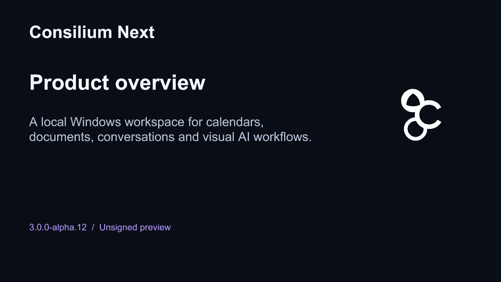</a><br />Product overview</td>
<td><a href="docs/media/promo/slide-2.png">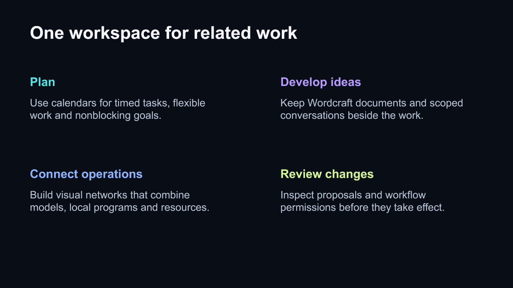</a><br />One workspace for related work</td>
</tr>
<tr>
<td><a href="docs/media/promo/slide-3.png">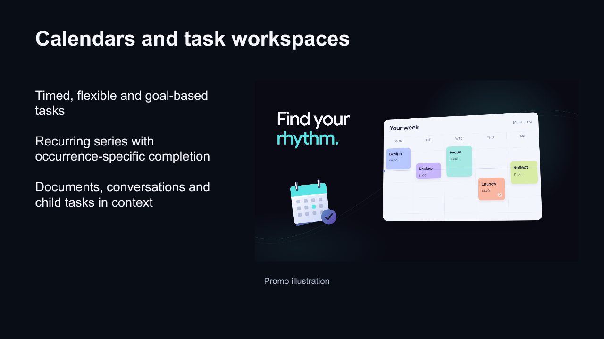</a><br />Calendars and task workspaces</td>
<td><a href="docs/media/promo/slide-4.png">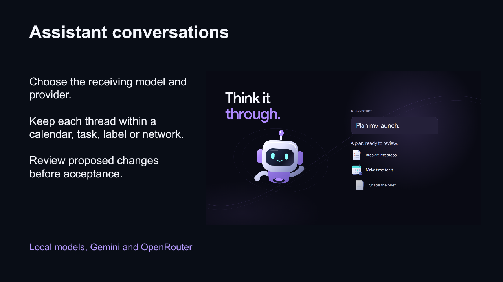</a><br />Assistant conversations</td>
</tr>
<tr>
<td><a href="docs/media/promo/slide-5.png"></a><br />Connected workflows</td>
<td><a href="docs/media/promo/slide-6.png">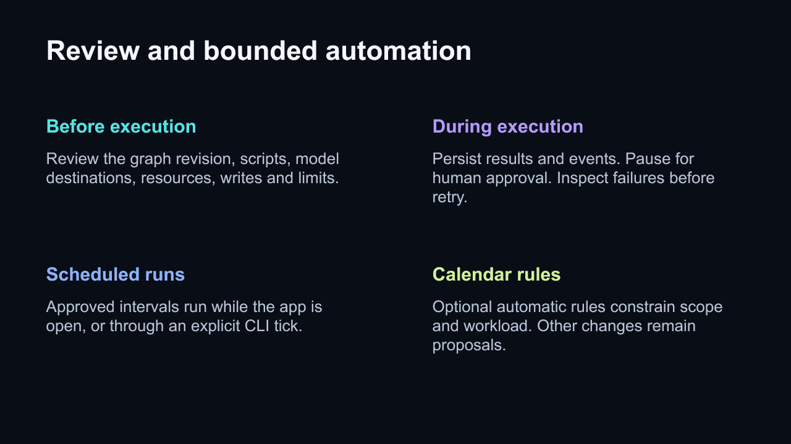</a><br />Review and bounded automation</td>
</tr>
<tr>
<td><a href="docs/media/promo/slide-7.png">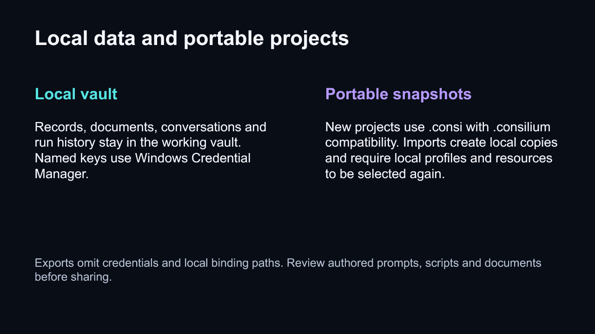</a><br />Local data and portable projects</td>
<td><a href="docs/media/promo/slide-8.png">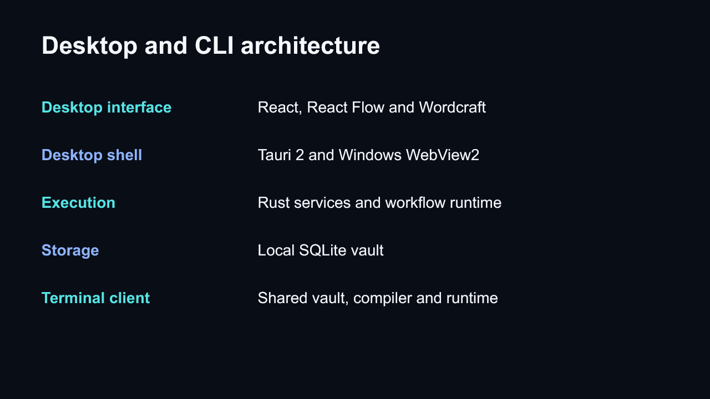</a><br />Desktop and CLI architecture</td>
</tr>
<tr>
<td><a href="docs/media/promo/slide-9.png">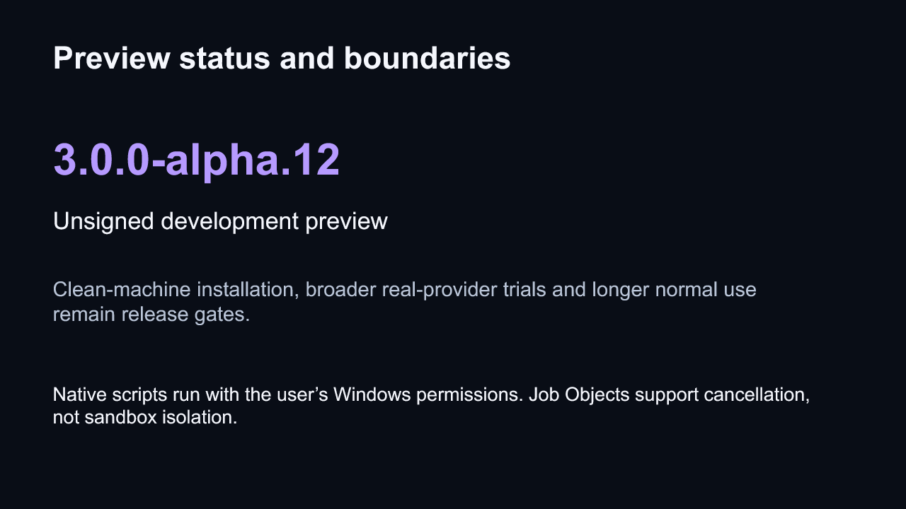</a><br />Alpha status and boundaries</td>
<td><a href="docs/media/promo/slide-10.png">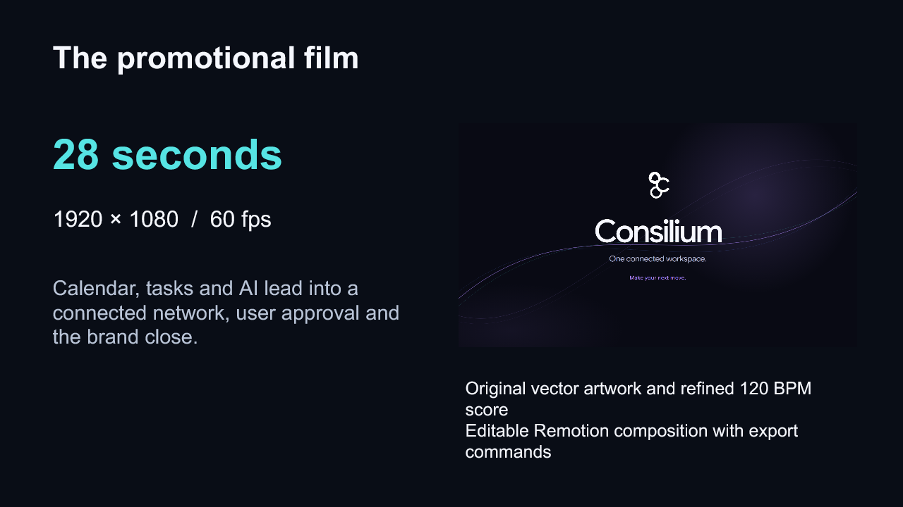</a><br />The promotional film</td>
</tr>
</table>

</details>

<details>
<summary>Product description — 5 pages</summary>

<table>
<tr>
<td><a href="docs/media/promo/word-1.png">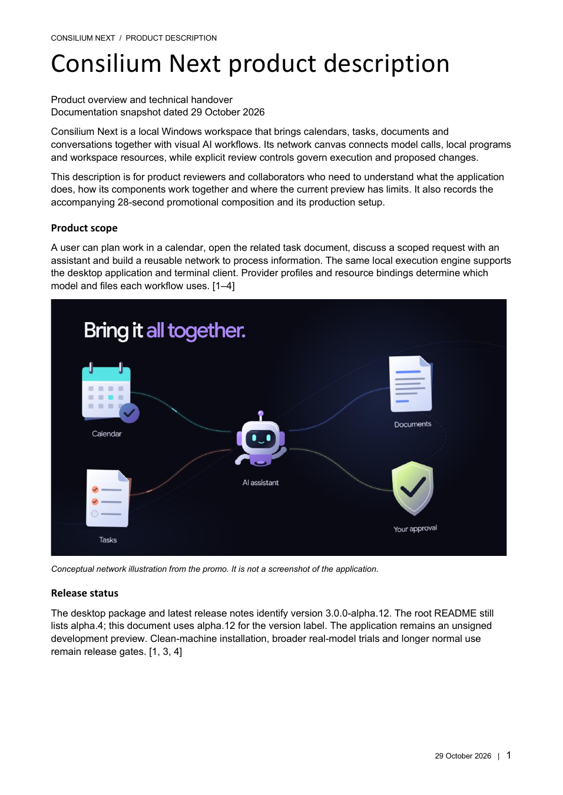</a><br />Product description</td>
<td><a href="docs/media/promo/word-2.png">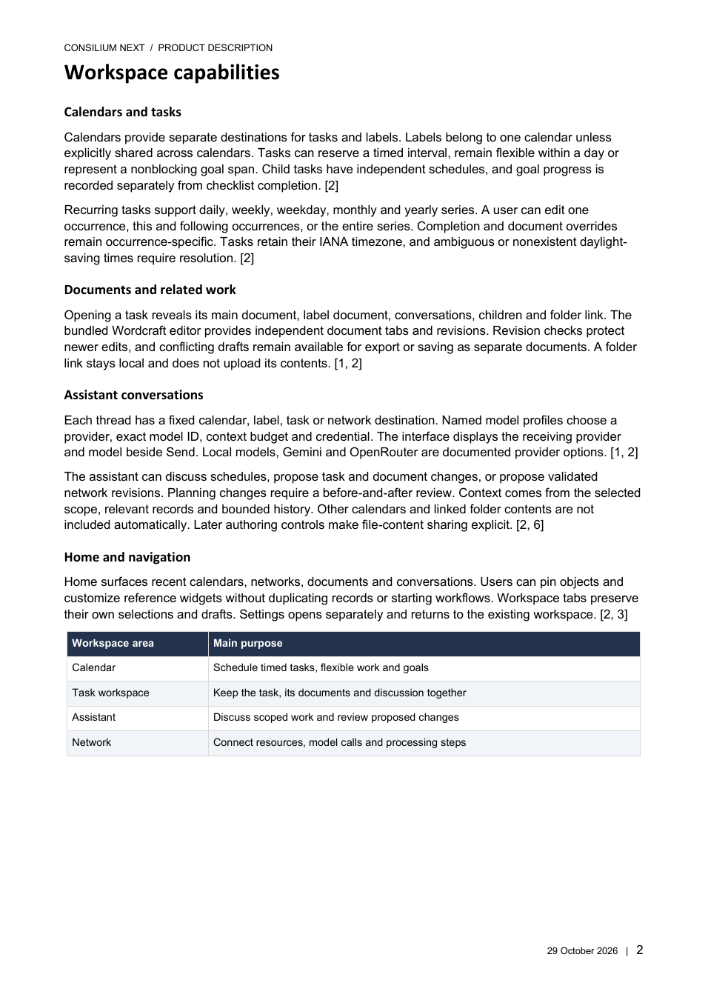</a><br />Workspace capabilities</td>
</tr>
<tr>
<td><a href="docs/media/promo/word-3.png">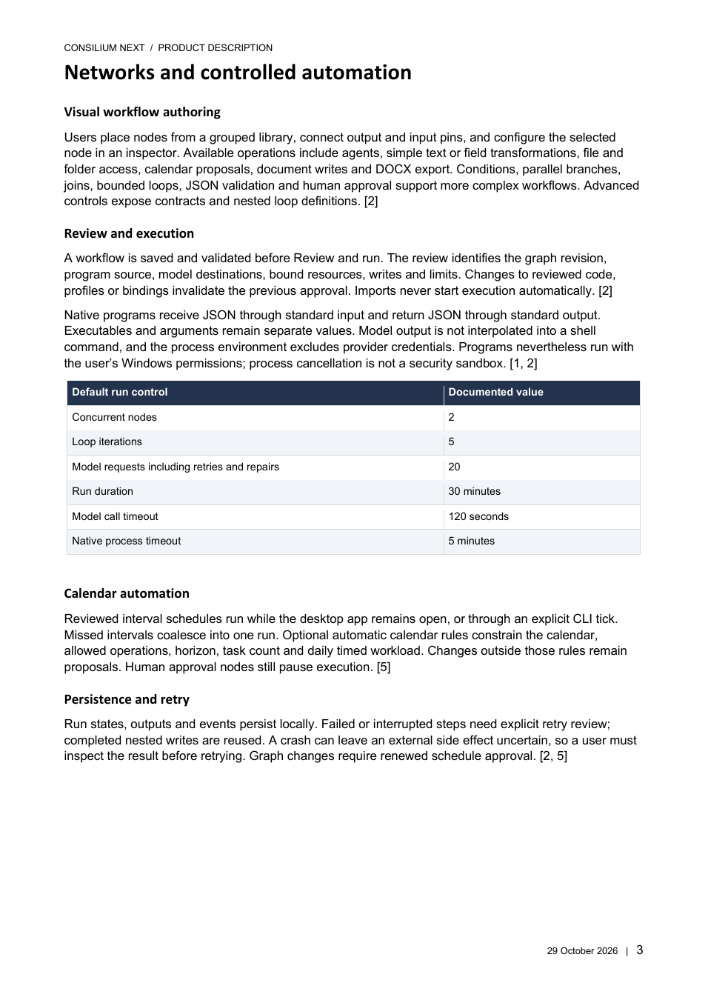</a><br />Networks and automation</td>
<td><a href="docs/media/promo/word-4.png">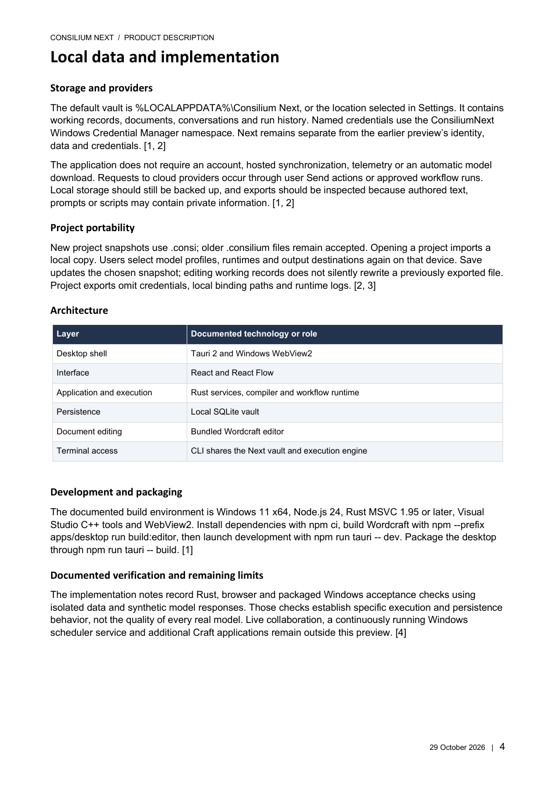</a><br />Data and architecture</td>
</tr>
<tr>
<td><a href="docs/media/promo/word-5.png">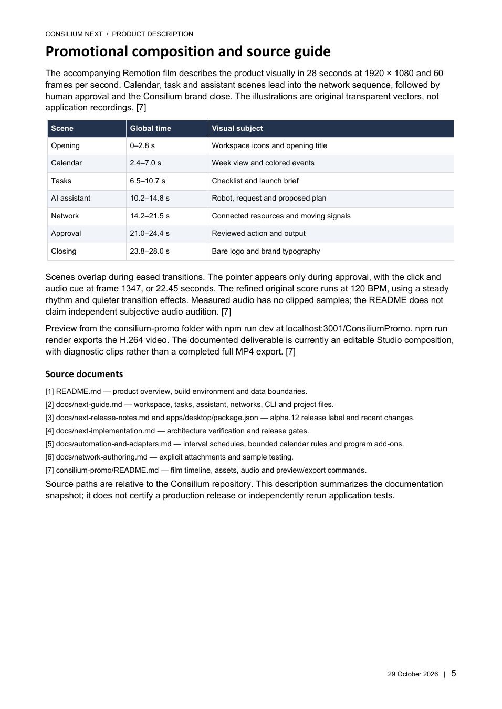</a><br />Promotional film and source guide</td>
</tr>
</table>

</details>

## What you can do

- Organize calendars, recurring tasks, goal spans, labels and checklist steps.
- Open task workspaces and Wordcraft documents in independent tabs.
- Chat with local models, Gemini or OpenRouter using separate model profiles and scoped context. Review proposed changes before applying them.
- Design and run visual workflows with agents, processes, explicit file inputs, documents, calendar changes and approval gates. Inspect node results and run history.
- Use the `consi` command to validate, package and run portable workflows without installing the desktop app.
- Customize the Home dashboard, colors, text size, spacing and calendar views.
- Optionally sync calendars with the [phone companion](https://nsl-eight.vercel.app/consilium/phone). Upload/download is reviewed and manual; documents, conversations, workflows, folders and provider keys are excluded from this version's sync.

## Start here

- [Workspace guide and CLI](docs/next-guide.md)
- [Release notes](docs/next-release-notes.md)
- [Release status and verification](docs/release-status.md)
- [Phone setup](docs/phone-sync.md)
- [Standalone runner](docs/standalone-runner.md)
- [Wordcraft licensing and build details](docs/wordcraft-integration.md)

## Build and verify

Windows 11 x64, Node.js 24, Rust MSVC 1.95+, Visual Studio C++ build tools and WebView2 are required.

```powershell
npm ci
npm --prefix apps/desktop run build:editor
npm run tauri -- dev
```

```powershell
cargo fmt --all -- --check
cargo test --workspace --exclude consilium --locked
npm test
node apps/desktop/tests/phone-sync-schema.mjs
npm --prefix apps/desktop test -- --config playwright.phone.config.ts
npm run tauri -- build
```

From `apps/desktop`, run `node tests/next-native.mjs` after packaging. It uses a temporary vault and synthetic local provider to exercise desktop and CLI workflows without personal keys.

Build outputs include `target/release/consilium-next.exe`, `target/release/consi.exe`, `target/release/consilium.exe` and `target/release/bundle/nsis/Consilium Next_3.0.0_x64-setup.exe`. The installer includes the terminal client in its `cli` directory. See the runner guide for optional PATH setup. Use Tauri to package desktop binaries; a direct Cargo desktop build requires `--features tauri/custom-protocol`.

## Data and execution

Notes and structured workspace records stay on the computer unless you explicitly share content with a selected model or use account synchronization. Named provider keys use Windows Credential Manager's `ConsiliumNext` namespace. The public Supabase publishable key identifies the account service; it is intentionally public and does not grant administrator access.

Workflows run after review. Optional automation must be explicitly enabled. Native scripts run with the user's permissions; Windows Job Objects manage ordinary child processes and are not a sandbox. Linking a folder does not upload its contents. Exports exclude credentials and device bindings; inspect authored scripts and prompts before sharing.

The core app uses the MIT license. Wordcraft and bundled dependencies retain their own licenses. Live collaboration and further Craft integrations remain future work.
